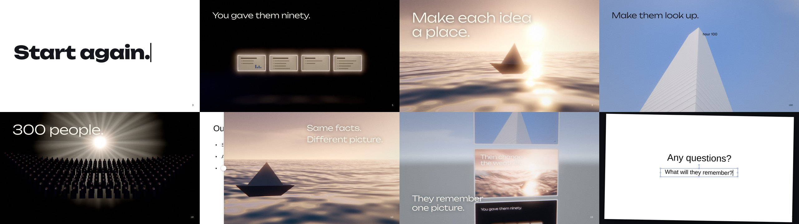

# god-slide

**Cinematic slide decks, made by Claude.** Every slide is a rendered picture: real-time 3D worlds, kinetic type, film-grade transitions, a counter that tells its own story, and speaker notes with stage directions. The presenter paces it one beat at a time. The output is one self-contained HTML file that works offline.



*Frames from the example deck, [`examples/nobody-remembers-your-slides`](examples/nobody-remembers-your-slides): a seven-minute talk about presenting that uses every device it describes.*

## Two modes

| | **normal** | **supreme** |
|---|---|---|
| When | You invoke the skill or ask for god or cinematic slides | Picked automatically for demo days, pitch decks, conference talks, keynotes and other high-stakes talks (or say "supreme") |
| Look | 2–4 hero scenes in full 3D, the rest kinetic type on living backdrops | Every scene is its own world |
| Craft | One signature device | Two to four devices, a deliberate transition per scene, full transition QA |

## Install

**Claude (claude.ai, desktop, mobile).** Add [`SKILL.md`](SKILL.md) as a custom skill. When the skill runs, Claude fetches the rest of this repo (engine, fonts, scripts) into its workspace by itself.

**Claude Code.**
```bash
git clone https://github.com/ZelinZhu-Richard/god-slide-skill ~/.claude/skills/god-slide
npm install --prefix ~/.claude/skills/god-slide
```

Then just ask:

> Use god-slide to make a 10-minute talk for my lab meeting on why our model fails on small objects.

> Pitch deck for demo day: 4 minutes, we make home batteries cheaper.

The second request triggers supreme mode on its own.

## Build a deck by hand

```bash
node scripts/new-deck.mjs my-talk --mode supreme --title "My Talk"   # scaffold
node scripts/build.mjs my-talk                                        # -> my-talk/dist/my-talk.html
node scripts/snap.mjs my-talk --transitions                           # screenshots + contact sheet + thumbnails
node scripts/build.mjs my-talk                                        # second build embeds the thumbnails
```

Requirements: Node 18+, and Chrome or Chromium for `snap.mjs` (found automatically, or set `CHROME_PATH`).

## Presenting

Open the HTML file in Chrome and press **F**.

| Key | Action |
|---|---|
| → / space / click | Next beat |
| ← | Back (motion rewinds) |
| F | Full screen |
| N / P | Speaker notes / presenter window |
| O | Overview of all slides |
| A | Play by itself |
| M | Sound on or off (off by default) |
| B or . | Black screen |
| ? | Help |

`#scene-id/2` in the URL opens a scene at beat 2. `?lite` lowers the resolution on weak laptops.

## What's inside

```
SKILL.md                  the skill: modes, workflow, craft rules, scene contract
references/               storytelling (with a case study), design system, engine API, cookbook, QA
engine/                   the runtime: scenes and beats, transitions, film pipeline, type layer
engine/kit/               sky, ocean, city, terrain, particles, globe, cards, glare, rigs, backdrops, selection box
scripts/                  new-deck, build (one-file HTML via esbuild), snap (headless QA)
templates/starter/        the scaffold for a new deck
examples/                 the showcase deck (source, built HTML, thumbnails)
fonts/                    Unbounded, Geist, Geist Mono, Newsreader, Anton, JetBrains Mono, Silkscreen (OFL)
```

## Credits

The craft is studied from a deck called *The Last Boring Slide*. This repository contains none of its code or content; `references/storytelling.md` describes what it does. Built on [three.js](https://threejs.org) (MIT). Fonts under the SIL Open Font License 1.1; their licence texts are in `fonts/licenses/`.

## License

MIT, see [LICENSE](LICENSE). Fonts are OFL-licensed, three.js is MIT.
